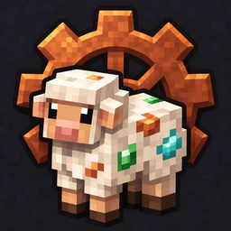

  

# Wool Works

**Turn a flock of sheep into a wool-powered resource industry.**

Craft special feed, transform ordinary sheep into resource sheep, and shear their Infused Wool. Extract the resources you need—or turn wool into energy to keep your farm running.

> **Screenshots TODO:** Add real in-game screenshots of resource sheep, machines and automation.

## What you can build

- **Resource Sheep:** Feed an adult sheep to give its wool a resource of your choice. Shear it and let it graze to regrow its fleece.
- **Wool Extractor:** Process Infused Wool into useful materials. Add Speed or Overdrive Upgrades to improve production.
- **Wool Generator:** Turn Infused Wool into Forge Energy (FE) for your machines.
- **Wool Insulated Cable:** Connect machines and move FE around your farm. Use shears to configure extraction connections.
- **Wool Worker:** Automate shearing and use wheat to regrow wool in a configurable area.
- **Woolly Muffler:** Set machines—and, around a Wool Worker, nearby sheep—to quieter sound modes.

## Getting started

1. Craft Resource Feed from wheat and a resource, such as an iron ingot.
2. Use the feed on an **adult vanilla sheep** to create a Resource Sheep.
3. Shear it for Infused Wool, then let it eat grass to regrow its fleece. Resource Sheep do not spawn naturally or breed.
4. Build a Wool Extractor to recover materials, or a Wool Generator to produce FE.
5. Connect machines with Wool Insulated Cable and expand your farm with a Wool Worker and upgrades.

The Wool Works advancement tab offers an in-game guide. JEI is helpful for looking up recipes and variants, but is not required.

## Modded materials and compatibility

Wool Works automatically enables supported materials from installed mods when their common item tags are available. No specific resource mod is required. Resource availability can also be configured; see the [Modpack Author Guide](docs/modpack-customization.md) for details.

[JEI](https://github.com/mezz/JustEnoughItems) can show recipes and resource variants. [Jade](https://github.com/Snownee/Jade) can show machine and sheep information; detailed machine data on a dedicated server requires Jade on both server and client. Both integrations are optional.

Manual compatibility testing has covered KubeJS recipe customization, Almost Unified, external FE systems and item automation, including Pipez. Individual mod versions and configurations can differ; this is not a guarantee of universal compatibility.

## Installation

1. Install **Minecraft Java Edition 1.21.1** and **NeoForge 21.1.267 or newer in the 21.1.x series**.
2. Place the Wool Works release JAR in the instance's `mods` folder. For multiplayer, install it on both the server and connecting clients.
3. Launch the game. JEI, Jade and material-providing mods may be installed separately, but none is required.

> **Alpha notice:** Wool Works is an early public alpha. Bugs, balance changes and compatibility issues may occur. Back up important worlds before updating.

## More information

- [Modpack Author Guide](docs/modpack-customization.md)
- [Developer Guide](docs/development.md)
- [Changelog](CHANGELOG.md)
- [Report an issue or suggest a feature](https://github.com/maartentje/WoolWorks/issues)
- [License](LICENSE.txt)
