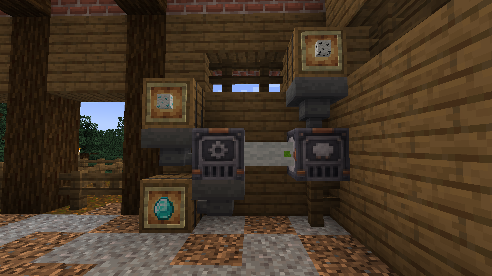

# Modpack Author Guide

Wool Works uses predefined optional resources rather than discovering arbitrary materials. An optional resource becomes available when automatic resources are enabled, its ID is not individually disabled, its definition is enabled, and its required item tag contains at least one item. No external material mod is mandatory. See the [complete examples](../examples/README.md) for an independently selectable KubeJS test script and a custom-resource datapack.

## Resource definitions and configuration

Resource types are datapack registry entries at `data/<namespace>/woolworks/resource_type/<name>.json`. Their ID is `<namespace>:<name>`. Existing definitions require `translation_key`, `color` (decimal RGB), `min_yield`, and `max_yield`. A resource pack can provide the corresponding translation. The registry is synchronized to connected clients when they join.

For example, `data/example/woolworks/resource_type/ruby.json`:

```json
{"translation_key":"resource.example.ruby","color":13249582,"min_yield":1,"max_yield":3,"category":"gems_crystals"}
```

Definitions are replaced as complete files by higher-priority datapacks; they are not merged. A full definition may include `"enabled": false` (default: true). The server config also provides `disabledResources`, a list of resource IDs. Disabled resources are omitted from the creative tab and machine ghost items and cannot be used to transform or shear sheep; the default feed and extraction recipes check availability. Existing items retain their resource IDs, but unavailable Resource Sheep are permanently converted to white vanilla sheep when loaded. Back up worlds before changing definitions.

The optional `category` field accepts `metals`, `alloys`, `gems_crystals`, `materials`, `mob_drops`, or `essences`; omitted fields default to `materials` for existing datapacks. Each category has an independent server setting, enabled by default. Category restrictions apply to both vanilla and modded resources and do not alter `disabledResources`; re-enabling a category preserves individual restrictions. The automatic modded toggle remains independent.

Colors are decimal RGB values from 0 to 16777215. Yields are integers from 1 to 64, with `min_yield` no greater than `max_yield`. Invalid definitions can prevent a world from loading. Resource IDs are stored on items and sheep, so avoid renaming them. Add translations with a resource pack available to clients, for example `assets/example/lang/en_us.json` containing `{"resource.example.ruby":"Ruby"}`.

For example, in `woolworks-server.toml`:

```toml
disabledResources = ["woolworks:osmium", "woolworks:amethyst", "example:ruby"]
enableAutomaticModdedResources = true
enableMetals = true
enableAlloys = true
enableGemsCrystals = true
enableMaterials = true
enableMobDrops = true
enableEssences = true
```

Set `enableAutomaticModdedResources` to `false` to disable all predefined optional resources without disabling vanilla or custom resources. Optional definitions specify `"automatic": true` and `"required_item_tag"`; both the setting and a nonempty tag are required. Custom definitions default to `"automatic": false`, and may use `required_item_tag` without being affected by the global setting. Individual disabling still applies. Restart the server and reconnect clients after changes; live reload and client display refresh are not guaranteed.

In an unpublished singleplayer world, the server configuration screen's **Enabled Resources** editor provides a searchable list of loaded resources and All Resources, Enabled Only, and Disabled Only display filters. The filters reflect effective restrictions and do not change settings. Done saves individual choices; Cancel discards them. Category-disabled and globally disabled resources retain their individual preferences. Unavailable automatic resources are hidden, but their saved IDs are retained. The registry is not available at the main menu; join a singleplayer world first. NeoForge prevents this server configuration from being edited from remote clients or a world open to LAN. Dedicated server administrators should edit the server config file instead.

## Supported catalogue

All IDs use the `woolworks:` namespace. The 38 vanilla resources are coal, copper, iron, gold, redstone, lapis, diamond, emerald, quartz, netherite_scrap, amethyst, echo_shard, prismarine_shard, prismarine_crystals, glowstone_dust, flint, clay_ball, ender_pearl, blaze_rod, breeze_rod, slimeball, magma_cream, ghast_tear, phantom_membrane, bone, string, gunpowder, spider_eye, leather, feather, rotten_flesh, shulker_shell, rabbit_hide, rabbits_foot, ink_sac, glow_ink_sac, turtle_scute and armadillo_scute. Feed and extraction use the corresponding vanilla items; `amethyst` uses `minecraft:amethyst_shard`, `slimeball` uses `minecraft:slime_ball` and `rabbits_foot` uses `minecraft:rabbit_foot`. These remain independent of the automatic-resources switch, but may be disabled individually or by category. The former alpha `woolworks:netherite` resource is no longer valid; existing sheep with that resource are handled as invalid resources.

The following 128 optional resources require the indicated nonempty item tag. The `woolworks:materials/*` tags use optional item entries and are empty when their provider is absent; datapacks may replace or extend them as usual.

The Coke and Dark Gem material tags also include their respective common tags when available, alongside optional exact-item fallbacks. Monazite and Dragonyst use dust, Pyrite uses an ingot, Utherium uses the Utheric Cluster, and Rubber uses Dry Rubber. Resources sharing a common tag use one resource type and deterministic extraction output.

| Resource ID | Required item tag |
| --- | --- |
| aquamarine | `c:gems/aquamarine` |
| jade | `c:gems/jade` |
| opal | `c:gems/opal` |
| garnet | `c:gems/garnet` |
| onyx | `c:gems/onyx` |
| amber | `c:gems/amber` |
| malachite | `c:gems/malachite` |
| tourmaline | `c:gems/tourmaline` |
| alexandrite | `c:gems/alexandrite` |
| tanzanite | `c:gems/tanzanite` |
| spinel | `c:gems/spinel` |
| citrine | `c:gems/citrine` |
| moonstone | `c:gems/moonstone` |
| sunstone | `c:gems/sunstone` |
| ametrine | `c:gems/ametrine` |
| ammolite | `c:gems/ammolite` |
| black_diamond | `c:gems/black_diamond` |
| iolite | `c:gems/iolite` |
| kunzite | `c:gems/kunzite` |
| kyanite | `c:gems/kyanite` |
| cinnabar | `c:gems/cinnabar` |
| black_quartz | `c:gems/black_quartz` |
| pyrite | `c:ingots/pyrite` |
| monazite | `c:dusts/monazite` |
| coke | `woolworks:materials/coke` |
| compressed_iron | `c:ingots/compressed_iron` |
| yellorium | `c:ingots/yellorium` |
| graphite | `c:ingots/graphite` |
| source_gem | `c:gems/source` |
| arcane_crystal | `c:gems/arcane_crystal` |
| arcane_gold | `c:ingots/arcane_gold` |
| dragonyst | `c:dusts/dragonyst` |
| dark_gem | `woolworks:materials/dark_gem` |
| cloggrum | `c:ingots/cloggrum` |
| froststeel | `c:ingots/froststeel` |
| forgotten_metal | `c:ingots/forgotten_metal` |
| draconium | `c:ingots/draconium` |
| awakened_draconium | `c:ingots/draconium_awakened` |
| rubber | `woolworks:materials/rubber` |
| boron_ingot | `woolworks:materials/boron_ingot` |
| enriched_iron | `woolworks:materials/enriched_iron` |
| quartz_enriched_iron | `woolworks:materials/quartz_enriched_iron` |
| quartz_enriched_copper | `woolworks:materials/quartz_enriched_copper` |
| spirit_attuned_gem | `woolworks:materials/spirit_attuned_gem` |
| dimensional_shard | `woolworks:materials/dimensional_shard` |
| utherium | `woolworks:materials/utherium` |
| desh | `woolworks:materials/desh` |
| ostrum | `woolworks:materials/ostrum` |
| calorite | `woolworks:materials/calorite` |
| osmium | `c:ingots/osmium` |
| tin | `c:ingots/tin` |
| silver | `c:ingots/silver` |
| lead | `c:ingots/lead` |
| zinc | `c:ingots/zinc` |
| uranium | `c:ingots/uranium` |
| nickel | `c:ingots/nickel` |
| platinum | `c:ingots/platinum` |
| aluminum | `c:ingots/aluminum` |
| titanium | `c:ingots/titanium` |
| tungsten | `c:ingots/tungsten` |
| iridium | `c:ingots/iridium` |
| cobalt | `c:ingots/cobalt` |
| bismuth | `c:ingots/bismuth` |
| iesnium | `c:ingots/iesnium` |
| steel | `c:ingots/steel` |
| bronze | `c:ingots/bronze` |
| brass | `c:ingots/brass` |
| electrum | `c:ingots/electrum` |
| invar | `c:ingots/invar` |
| constantan | `c:ingots/constantan` |
| cupronickel | `c:ingots/cupronickel` |
| signalum | `c:ingots/signalum` |
| lumium | `c:ingots/lumium` |
| enderium | `c:ingots/enderium` |
| stainless_steel | `c:ingots/stainless_steel` |
| refined_obsidian | `c:ingots/refined_obsidian` |
| refined_glowstone | `c:ingots/refined_glowstone` |
| allthemodium | `c:ingots/allthemodium` |
| vibranium | `c:ingots/vibranium` |
| unobtainium | `c:ingots/unobtainium` |
| conductive_alloy | `c:ingots/conductive_alloy` |
| dark_steel | `c:ingots/dark_steel` |
| end_steel | `c:ingots/end_steel` |
| energetic_alloy | `c:ingots/energetic_alloy` |
| pulsating_alloy | `c:ingots/pulsating_alloy` |
| redstone_alloy | `c:ingots/redstone_alloy` |
| soularium | `c:ingots/soularium` |
| vibrant_alloy | `c:ingots/vibrant_alloy` |
| manasteel | `c:ingots/manasteel` |
| terrasteel | `c:ingots/terrasteel` |
| elementium | `c:ingots/elementium` |
| mana_diamond | `c:gems/mana_diamond` |
| mana_pearl | `c:gems/mana_pearl` |
| inferium_essence | `woolworks:materials/inferium_essence` |
| prudentium_essence | `woolworks:materials/prudentium_essence` |
| tertium_essence | `woolworks:materials/tertium_essence` |
| imperium_essence | `woolworks:materials/imperium_essence` |
| supremium_essence | `woolworks:materials/supremium_essence` |
| prosperity_shard | `woolworks:materials/prosperity_shard` |
| soulium_ingot | `c:ingots/soulium` |
| hop_graphite | `c:ingots/hop_graphite` |
| fiery_ingot | `c:ingots/fiery` |
| ironwood | `c:ingots/ironwood` |
| knightmetal | `c:ingots/knightmetal` |
| steeleaf | `c:ingots/steeleaf` |
| uraninite | `woolworks:materials/uraninite` |
| energized_steel | `woolworks:materials/energized_steel` |
| blazing_crystal | `woolworks:materials/blazing_crystal` |
| niotic_crystal | `woolworks:materials/niotic_crystal` |
| spirited_crystal | `woolworks:materials/spirited_crystal` |
| nitro_crystal | `woolworks:materials/nitro_crystal` |
| silicon | `c:silicon` |
| sky_stone | `woolworks:materials/sky_stone` |
| azure_electrum | `c:ingots/azure_electrum` |
| azure_silver | `c:ingots/azure_silver` |
| blaze_gold | `c:ingots/blaze_gold` |
| crimson_iron | `c:ingots/crimson_iron` |
| crimson_steel | `c:ingots/crimson_steel` |
| ruby | `c:gems/ruby` |
| sapphire | `c:gems/sapphire` |
| peridot | `c:gems/peridot` |
| topaz | `c:gems/topaz` |
| fluorite | `c:gems/fluorite` |
| certus_quartz | `c:gems/certus_quartz` |
| fluix (Fluix Crystal) | `c:gems/fluix` |
| apatite | `c:gems/apatite` |
| sulfur | `c:dusts/sulfur` |
| salt | `c:dusts/salt` |

The published 1.21.1 AE2 tag files use `c:gems/certus_quartz` and `c:gems/fluix`, and Mekanism's 1.21.x data uses `c:gems/fluorite`; these names were checked against source data, not verified with every mod version. Individual mods or packs may use other tags: add their items to the listed common tag with a datapack if needed. When a tag has multiple items, extraction picks the lowest registry ID in sorted order.

## Custom Feed and extraction recipes

**Minecraft 26.1.2:** use datapack format 101.1 (`min_format` and `max_format` set to `[101, 1]`). A resource-definition override was tested during the port; the complete examples below have not been independently runtime-tested. Existing 1.21.1 overrides must change ingredient objects such as `{"item":"minecraft:wheat"}` to `"minecraft:wheat"`, and `{"tag":"c:ingots/tin"}` to `"#c:ingots/tin"`. Custom ingredient objects use `"neoforge:ingredient_type"` instead of `"type"`; top-level recipe `"type"` is unchanged. Review external datapacks and KubeJS scripts before upgrading; recipe IDs and resource components remain unchanged.

Recipes are standard datapack resources under `data/<namespace>/recipe/`, and can be replaced by another datapack at the same ID. For example, the existing Feed and extraction IDs for iron are `woolworks:iron_feed` and `woolworks:extraction/iron`. Replacing one does not require replacing the other.

For the `example:ruby` definition above, `data/example/recipe/ruby_feed.json` can use the existing conditional shapeless serializer. This example uses a diamond as its ingredient, so it needs no other mod:

```json
{
  "type": "woolworks:resource_conditional_crafting",
  "required_resource": "example:ruby",
  "recipe": {
    "ingredients": ["minecraft:wheat", "minecraft:diamond"],
    "result": {
      "id": "woolworks:resource_feed",
      "count": 1,
      "components": {"woolworks:resource_type": "example:ruby"}
    }
  }
}
```

Add `data/example/recipe/extraction/ruby.json` to extract one diamond from that resource's wool:

```json
{
  "type": "woolworks:wool_extraction",
  "ingredient": {
    "neoforge:ingredient_type": "neoforge:components",
    "items": "woolworks:infused_wool",
    "components": {"woolworks:resource_type": "example:ruby"}
  },
  "result": {"id": "minecraft:diamond", "count": 1},
  "duration": 200,
  "energy_per_tick": 40,
  "required_resource": "example:ruby"
}
```

`required_resource` checks availability. For a tag-selected output, use `"result_tag": "c:ingots/tin"` instead of `result`; it produces one deterministically selected item. Use an explicit `result` for a particular item or a different quantity. If both fields are present, `result_tag` takes precedence. Recipes and definitions are separate files and must be supplied or overridden independently.

## KubeJS and compatibility

KubeJS is optional. For example, a server script can remove just the Tin Feed recipe:

```js
ServerEvents.recipes(event => {
  event.remove({ id: 'woolworks:tin_feed' })
})
```

The [example script](../examples/kubejs/server_scripts/woolworks_test.js) also shows raw-JSON replacements for Tin Feed and extraction. Enable one case at a time; see its [instructions](../examples/README.md). Earlier manual compatibility testing applied to the 1.21. The examples target 26.1.2; KubeJS integration has not been verified on this version. Test your own pack and inspect logs.

## Other machine configuration and recipes



*A wool-processing setup using an Extractor and Generator.*

The world server config `serverconfig/woolworks-server.toml` also provides `cableTransferRate` (default 160 FE/t per cable segment), `woolWorkerOperationInterval` (200 ticks), `woolWorkerRegrowthEnergyCost` (400 FE), `woolWorkerShearingEnergyCost` (200 FE), `woolWorkerWheatCost` (1) and `woolWorkerShearsDurabilityCost` (0). Existing config files retain their saved values. Worker energy costs are capped at its 20,000 FE capacity. Check the server log for the effective config path when a development or host setup provides an override. Server configuration is synchronized to connected clients.

In 26.1.2, newly placed cables automatically enable extraction from adjacent Wool Generators. Unknown external energy handlers default to passive connections; use shears on the relevant cable face to enable or disable extraction manually. Existing extraction masks are retained, including when a producer is empty. Extraction can also be toggled on receive-only machines; doing so does not make them supply energy.

Generator fuel recipes use `woolworks:generator_fuel` with `ingredient`, `burn_ticks` and `energy_per_tick`; `required_resource` and `absent_resource` are optional availability checks. Fuel must be valid Infused Wool. The default `woolworks:generator/infused_wool` recipe supplies 400 ticks at 40 FE/t; matching custom fuel recipes take precedence over that default. Extraction recipes support `required_resource`; their duration and FE/t are datapack fields. Speed upgrades keep configured FE/t, whereas Overdrive multiplies FE/t and output; extraction pauses if the output cannot fit.

The two cable recipes are independently replaceable: `woolworks:wool_insulated_cable` uses Copper Infused Wool and shears for eight cables, while `woolworks:wool_insulated_cable_fallback` uses copper, wool and shears for four. Their `reusable_shears` field returns shears with one durability consumed, preserving other components. The speed upgrade recipe uses the `woolworks:infused_wool` ingredient and `validate_resource_wool` to reject unavailable variants.

See the [testing checklist](testing.md) for datapack, integration and multiplayer scenarios. Resource definition and tag changes require a world/server restart and client reconnect; full live reload synchronization has not been established.
